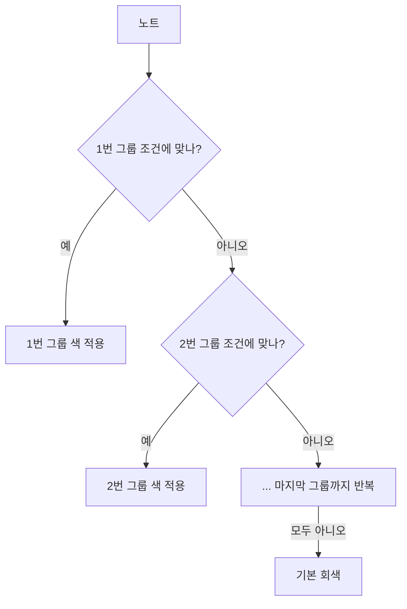

# 그래프 색상 규칙

> 그래프 뷰에서 노트 색이 어떻게 정해지는지 정리한 볼트 운영 문서입니다.
> 설정 위치: 그래프 뷰 → 오른쪽 위 설정(⚙️) → **Groups**

## 색이 칠해지는 방식

1. 그래프 뷰는 각 노트를 **Groups 목록의 위에서부터** 하나씩 검사합니다.
2. 각 그룹의 조건은 검색창 문법과 같습니다. 예를 들어 `path:CS/`는 "경로에 `CS/`가 들어간 노트"라는 뜻입니다.
3. 노트가 여러 그룹에 해당하면 **목록에서 더 위에 있는 그룹**의 색이 적용됩니다.
4. 어느 그룹에도 해당하지 않으면 기본 회색으로 표시됩니다(예: README, 지식 맵, Backlog).
5. 아직 만들지 않은 노트로 가는 링크(Unresolved)는 흐린 점으로 표시되고, 그룹 색이 적용되지 않습니다.

### `path:` 조건의 주의점
- **일부 일치:** 경로 중 일부만 맞아도 해당됩니다. `path:Swift`라고 쓰면 `SwiftUI/`, `Swift_Concurrency/`도 모두 해당됩니다.
- **대소문자 무시:** `path:CS`는 `Basics.md`처럼 경로에 "cs"가 들어간 노트도 잡습니다.
- 그래서 **모든 조건 끝에 `/`를 붙여** 폴더 이름까지만 정확히 맞도록 했습니다.

## 현재 그룹 목록

| 순서 | 조건 | 색 | 대상 |
|---|---|---|---|
| 1 | `path:SwiftUI/` | 🔵 파랑 `#4A90E2` | [[SwiftUI]] |
| 2 | `path:Combine/` | 🟣 보라 `#9B59B6` | [[Combine]] |
| 3 | `path:Swift_Concurrency/` | 🟠 주황 `#E67E22` | [[Swift_Concurrency]] |
| 4 | `path:Swift/` | 🔴 주황빨강 `#F05138` | [[Swift]] |
| 5 | `path:iOS/` | 🟢 초록 `#2ECC71` | [[iOS]] |
| 6 | `path:CS/` | ⚪ 회색 `#95A5A6` | [[CS]] |
| 7 | `path:자료구조/` | 🟡 노랑 `#F1C40F` | [[자료구조]] |
| 8 | `path:알고리즘/` | 🩵 청록 `#1ABC9C` | [[알고리즘]] |

## 색 선택 기준
- **Swift 언어 계열은 따뜻한 색:** Swift는 로고색인 주황빨강, 동시성은 주황입니다.
- **UI·반응형 프레임워크는 차가운 색:** SwiftUI는 파랑, Combine은 보라입니다.
- **iOS 플랫폼은 초록입니다.**
- **CS 기초는 Swift 계열과 확실히 구분되는 색:** CS는 회색, 자료구조는 노랑, 알고리즘은 청록입니다.

## 새 폴더를 추가할 때
1. Groups에서 **New group**을 누릅니다.
2. 조건을 `path:새폴더명/` 형식으로 입력합니다. 끝의 `/`를 잊지 마세요.
3. 색 동그라미를 눌러 색을 정합니다. 기존 색과 겹치지 않게 고릅니다.
4. 다른 그룹과 조건이 겹친다면, 우선 적용할 그룹을 목록 위쪽으로 드래그합니다.
5. 이 문서의 표에도 추가합니다.

## 다른 기준으로 색칠하기
- **태그 기준:** `tag:#면접` → 면접 대비 노트만 강조
- **파일 이름 기준:** `file:MOC` → 허브 노트만 강조
- **내용 기준:** `"Retain Cycle"` → 특정 단어가 들어간 노트 강조

폴더 그룹보다 **위에** 두면 폴더 색보다 우선 적용됩니다.

---
## 관련 노트
- [[README]]
- [[iOS_Developer_Knowledge_Map|iOS 개발자 지식 맵]]
